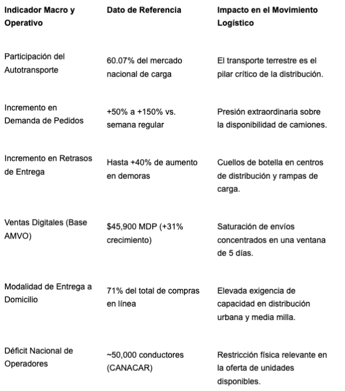
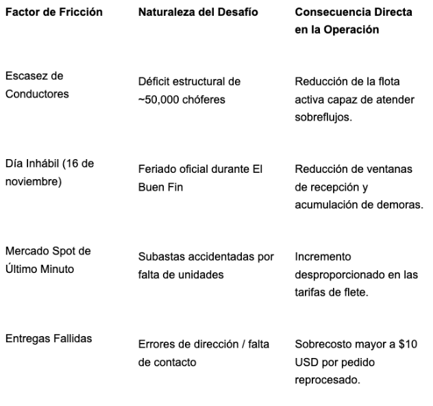
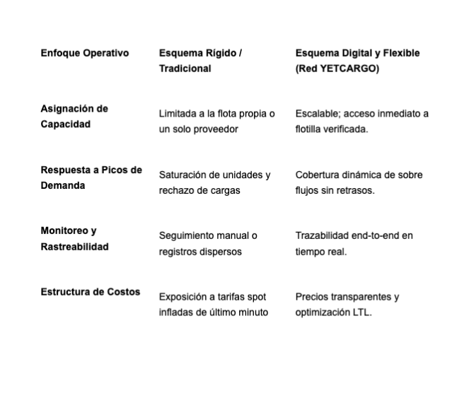

El Buen Fin 2026, programado del 13 al 17 de noviembre, representa la coyuntura operativa más intensa del año para la cadena de suministro en México. Durante este periodo de cinco días, el movimiento logístico experimenta un repunte masivo en la demanda de pedidos de entre un 50% y un 150%, lo que a su vez incrementa los retrasos en las entregas hasta en un 40% respecto a una semana operativa normal. Este fenómeno no responde a problemas circunstanciales de tráfico urbano o congestión vial imprevista: es un problema estructural de capacidad de autotransporte que se define y resuelve semanas antes de que inicien las promociones al consumidor.   

La dimensión del flujo logístico se comprende a partir del impacto macroeconómico de las ediciones recientes. En la edición previa de El Buen Fin, las ventas totales generaron $219,000 millones de pesos (+26.6% respecto al año anterior), con un canal digital (eCommerce) que aportó $45,900 millones de pesos (+31% interanual), alcanzando una penetración del 21% sobre las ventas totales con la participación de 216,000 comercios registrados. La demanda sobre la infraestructura de transporte es directa y severa, dado que el 71% de las compras requieren envío a domicilio, ejecutado en un 70% mediante flotillas dedicadas o contratadas por los propios comercios.   

La capacidad logística no se improvisa en noviembre; se diseña con anticipación. En YETCARGO entendemos la dinámica de la temporada alta porque operamos año con año en el centro del movimiento logístico nacional. Si la operación de transporte de una empresa depende de un solo proveedor, de una flotilla propia al límite de su capacidad o de subastas de último minuto en el mercado spot, El Buen Fin puede convertirse en una carrera crítica contra el reloj. En YETCARGO, el acceso inmediato a una red de transportistas verificados, con disponibilidad real y trazabilidad en tiempo real, permite cubrir los picos de demanda en el momento que se requiere sin inversión en flota propia.   

**Cuellos de Botella Estructurales en la Cadena de Suministro Terrestre**

El autotransporte por carretera concentra el 60.07% del mercado de carga y logística en México, convirtiéndolo en la arteria principal para el abastecimiento entre centros de manufactura, almacenes centrales y nodos de consumo metropolitanos. Sin embargo, la movilidad de mercancías durante el cuarto trimestre enfrenta fricciones operativas de consideración que limitan la oferta de transporte justo cuando la demanda alcanza su punto cúspide.   

**1. Déficit de Operadores y Factores Transfronterizos**

De acuerdo con estimaciones de la Cámara Nacional del Autotransporte de Carga (CANACAR), México registra un déficit superior a los 50,000 conductores profesionales de autotransporte, donde la inseguridad patrimonial en carreteras representa el principal obstáculo para atraer y retener personal. 

**2. Restricciones del Calendario Operativo**

El Buen Fin 2026 contempla un elemento crítico en su calendario: el lunes 16 de noviembre es festivo oficial (conmemoración del Aniversario de la Revolución Mexicana). Este fin de semana largo genera un cierre parcial o reducción de turnos en patios de maniobras, aduanas, plantas industriales y rampas de recepción de clientes, reduciendo el tiempo efectivo para descargar unidades y multiplicando los tiempos de permanencia en los nodos de entrega.   

**3. Elevación de Costos Operativos por Kilómetro**

El costo de operar un tráiler en México oscila entre $44.00 y $50.00 pesos por kilómetro (sin incluir maniobras, estancias ni seguros). Los ajustes en casetas de cobro de CAPUFE de abril de 2026 reflejan alzas en tramos clave; por ejemplo, en la ruta de Ciudad de México a Monterrey, el peaje alcanza una tarifa de referencia de aproximadamente $4,120 pesos para unidades de 9 ejes. Estos incrementos en peajes, sumados a la volatilidad del mercado spot en temporada alta, colocan un sobreprecio considerable a los trayectos ineficientes o a los retornos en vacío.   

**Estrategias Operativas para Optimizar el Flujo de Carga**

Para neutralizar el impacto de la sobrecarga operativa y asegurar que las mercancías lleguen a tiempo a sus destinos sin dilapidar el margen comercial, las organizaciones requieren adoptar un enfoque sistemático de gestión logística anticipada.   

**Integración de Visibilidad Digital en Tiempo Real**

La falta de digitalización en el transporte puede incrementar los costos operativos de una flota hasta en un 18%, de acuerdo con análisis de Métrica Móvil citados por la Revista Transportes y Turismo. La implementación de plataformas de visibilidad conectada e integración IoT para supervisar en vivo la posición de los camiones, prever desvíos y coordinar protocolos de reacción inmediata ante incidencias. Asimismo, la digitalización de la documentación obligatoria, incluidos el complemento Carta Porte, facturas y evidencias digitales de entrega (PoD),agiliza la facturación y reduce el capital de trabajo inmovilizado. Dado que un 13% de los consumidores teme sufrir retrasos en las entregas durante El Buen Fin, la información de rastreo en tiempo real resulta indispensable para preservar la satisfacción del cliente.   

**Consolidación Dinámica (LTL) y Eficiencia de Ruta**

Viajar con espacio subutilizado o realizar trayectos de retorno sin carga destruye el margen financiero en temporada alta. El Instituto Mexicano del Transporte (IMT) ha estudiado formalmente el impacto económico de los movimientos en vacío (Publicación técnica No. 74) y la formulación de modelos de ruteo vehicular para optimizar el factor de utilización (Publicación técnica No. 144). La consolidación de carga en modalidad LTL (Less-Than-Truckload) puede generar ahorros de hasta un 40% en costos de flete para los embarcadores bajo condiciones específicas. Asimismo, el uso de software de ruteo dinámico asistido por IA permite reducir los tiempos de tránsito en hasta un 30%. 

**Diversificación y Flexibilidad de Flota**

La dependencia de un único transportista o de una infraestructura fija no escala adecuadamente frente a incrementos del 50% al 150% en el volumen de pedidos. Integrar plataformas digitales como YETCARGO conecta de forma inmediata a los embarcadores con redes verificadas de transportistas. Esto facilita seleccionar la unidad idónea para cada trayecto, desde camionetas 3.5 hasta tráileres de 53 pies, adaptando el costo logístico a las necesidades reales del volumen sin asumir inversiones fijas ni contratos inflexibles.   

**Contrataciones de Emergencia**

A solo unos días del arranque de El Buen Fin 2026 la prioridad operativa cambia drásticamente: resolver las contrataciones de emergencia en el mes de noviembre sin arriesgar la operación ni el margen financiero. Cuando las ofertas ya están publicadas y las flotillas habituales quedan saturadas, depender de subastas improvisadas en el mercado spot abre la puerta a sobrecostos desmedidos y graves fallas en la entrega.

Para resolver las contingencias de capacidad y blindar la logística durante las jornadas de El Buen Fin 2026, las empresas pueden tomar medidas tácticas inmediatas de respuesta rápida:

* **Diagnóstico y asignación inmediata de volumen crítico: **Identificar las cargas con mayor riesgo de retraso por corredor logístico y compartirlas de inmediato con plataformas digitales conectadas para asegurar unidades antes del colapso del fin de semana.
* **Evitar la trampa del mercado spot descontrolado: **Sustituir las subastas de última hora con proveedores no auditados por redes digitales consolidadas que garanticen disponibilidad con operadores previamente verificados y precios competitivos.
* **Coordinación express de citas y horarios festivos: **Validar con urgencia las ventanas de recepción en almacenes y clientes finales considerando la reducción operativa por el feriado del lunes 16 de noviembre para evitar estadías y estancamiento de vehículos.
* **Validación acelerada de documentación digital:** Integrar de forma ágil e inmediata el complemento Carta Porte, facturas y folios aduanales en formato digital antes de que las unidades inicien el trayecto, evitando detenciones retenidas en carretera.
* **Gestión inmediata de excepciones y logística inversa:** Establecer protocolos rápidos de atención a entregas fallidas o devoluciones para evitar reprocesos manuales que erosionen las utilidades del evento.

En YETCARGO entendemos que las contingencias de noviembre exigen respuestas inmediatas. Por ello, brindamos acceso instantáneo a una red de transportistas debidamente auditada, ofreciendo disponibilidad real y trazabilidad en tiempo real para cubrir los picos de demanda de último minuto sin contratos rígidos ni inversión en flota propia.

Aún estás a tiempo de asegurar la capacidad de transporte para tu negocio durante El Buen Fin. Agenda hoy una consulta rápida con el equipo de YETCARGO y revisemos juntos qué necesitas mover, cuándo y con qué respaldo.

**Fuentes y Referencias**

_Asociación Mexicana de Venta Online (AMVO). (2026). Pulso El Buen Fin 2026: Los datos clave para la toma de decisiones en el eCommerce mexicano. AMVO Estudios._

_Asociación Mexicana de Venta Online (AMVO). (2026). Guía Integral y Checklist Estratégico El Buen Fin 2026._

_Cámara Nacional del Autotransporte de Carga (CANACAR). (2026). Reportes del sector autotransporte de carga sobre déficit de operadores y seguridad patrimonial en México._

_Compass Solutions. (2025). Peak season 2025/2026: Estrategias logísticas para la temporada alta en México._

_Echeverría, Á. / The Logistics World. (2026, 3 de noviembre). Buen Fin 2026: Logística y el reto de resolver entregas fallidas._

_Instituto Mexicano del Transporte (IMT). (1995). Impacto económico de los movimientos en vacío en el autotransporte nacional de carga (Publicación técnica No. 74)._

_Instituto Mexicano del Transporte (IMT). (2000). Problemas de ruteo vehicular en la recolección y distribución óptimas de carga (Publicación técnica No. 144)._

_Mordor Intelligence. (2026). Informe de crecimiento del mercado de carga y logística de México 2031._

_Revista Transportes y Turismo / Métrica Móvil. (2026, 20 de febrero). Falta de digitalización incrementa 18% los costos de las flotas de transporte._

_The Logistics World. (2025). Peak season: Estrategias logísticas para enfrentar la alta demanda._

_WhyLoyalty / Transporte.mx. (2026). Guía del costo de flete en México y calendarios de Peak Season._

**Nota de Atribución y Uso Informativo**

La información, estadísticas, estudios y datos de terceros incluidos en este artículo se presentan con fines exclusivamente informativos y de comunicación. Las cifras, metodologías, estimaciones, opiniones y conclusiones corresponden a sus respectivos autores, instituciones o fuentes originales. YETCARGO no reclama autoría sobre información desarrollada por terceros. Las referencias a estudios, instituciones, publicaciones, empresas o marcas de terceros tienen como finalidad identificar las fuentes utilizadas y proporcionar contexto al lector; su inclusión no implica afiliación, patrocinio, respaldo, certificación o asociación comercial con YETCARGO, salvo que se indique expresamente. Las opiniones, interpretaciones y propuestas relacionadas con YETCARGO corresponden a la empresa y se distinguen de los datos provenientes de fuentes externas. Se recomienda consultar las publicaciones originales para conocer su metodología, alcance, fecha de actualización y contexto.
